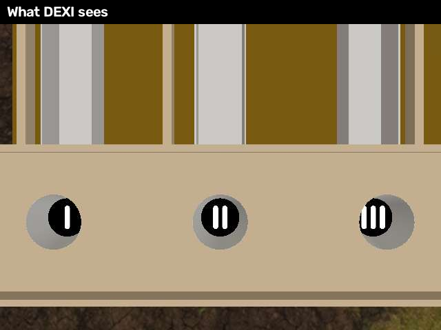
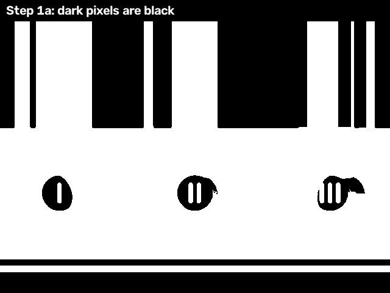
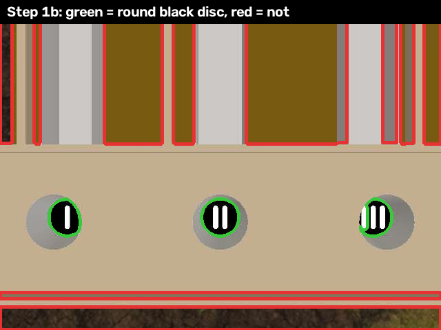
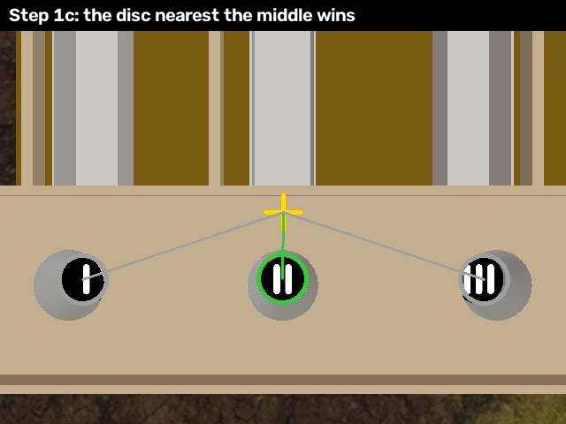
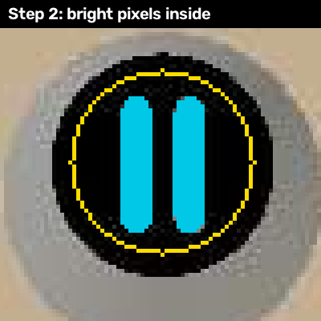
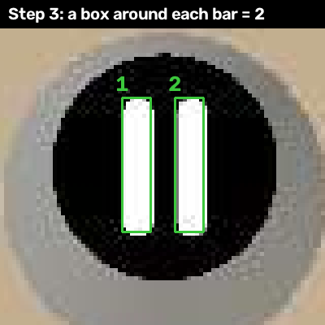
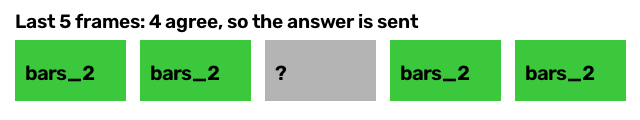

# How DEXI counts bars

The bridge cups on the AVR 2026 field each hold a sticker: a black circle with
1, 2 or 3 white bars, or no bars at all. DEXI has to say which one it is
looking at. It does this with a few simple steps, no AI model, the way you
might do it yourself with a marker and a ruler.

This is called **computer vision**: getting a computer to understand a
picture. The code is written in Python using **OpenCV**, a free computer
vision library. It runs on
DEXI as a ROS 2 node, a small program that reads the camera and publishes
what it finds.

Here is what the camera sees from 1 meter above the bridge:

There are three cups in the picture. DEXI is over the middle one.

## Step 1: find the black circle

**1a. Which pixels are dark?** A picture is a grid of tiny dots called pixels.
Each one has a brightness from 0 (black) to 255 (white). The computer picks a
cut-off that splits the picture into "dark" and "light" and keeps only the dark
pixels.

The cups' black circles show up, but the wooden stripes and dark edges came
through too, so the computer needs more clues.

> **Behind the scenes:** turning a picture into just black and white is called **thresholding**. The cut-off is picked automatically with **Otsu's method**, which finds the brightness that best splits the picture into two groups. Touching dark pixels are then grouped into shapes with **connected components**.

**1b. Which dark shapes are round?** For each dark shape the computer checks two
things:

- **Is it round?** It compares the shape to a perfect circle the same width. A
  stripe is long and thin, so it fails.
- **Is it darker than what is around it?** A black sticker sits on a light cup.
  A shadow on a wall does not stand out like that, so it fails.

Green passed, red did not. Three circles are left, one per cup.

> **Behind the scenes:** each shape's outline is a **contour**. Filling it in closes the holes the bars cut. Roundness is a **circularity** score: the shape's area divided by the area of a circle as wide as it is, so a perfect circle scores 1. "Darker than around it" compares the **median** brightness inside to a ring just outside.

**1c. Which circle is DEXI over?** DEXI is over the cup in the middle
of the picture, so the circle closest to the center (the yellow cross) wins.

> **Behind the scenes:** each shape's middle is its **centroid**. The winner is the one with the shortest straight-line distance to the center of the picture.

## Step 2: find the white bars

Now the computer zooms in on that one circle and looks for pixels that are much
brighter than the black around them. Those are the bars (blue). It only looks
inside the yellow ring, so the edge of the cup is not mistaken for a bar.

If there are no bright pixels at all, the circle is blank, and the answer is
`bars_0`.

> **Behind the scenes:** this is a second round of thresholding, done only inside the circle, with its own cut-off. Looking at one small area instead of the whole picture is called a **region of interest**.

## Step 3: count them

The computer draws the smallest box it can around each bright shape. A bar is
long and thin, so its box is tall and narrow. Then it counts the boxes.

The boxes can tilt, so this still works when DEXI is turned and the bars
are sideways.

> **Behind the scenes:** the tilted box is OpenCV's **minimum area rectangle**. Its long side divided by its short side, the **aspect ratio**, tells a bar from a blob.

## Step 4: double-check

Counting shapes can be fooled. If the camera is tilted, two bars can blur
together into one fat shape. So the computer checks a second way: it adds up
all the white pixels and asks "is that about how much white 2 bars should
have?" If the two answers disagree, it says nothing rather than guess.

> **Behind the scenes:** checking one answer with a second, independent measurement is a common trick in engineering. Here the second measurement is **pixel area**.

## Step 5: vote

One picture can be blurry, so DEXI does not trust just one. It keeps the
last 5 answers and only reports when at least 3 of them agree.

> **Behind the scenes:** this is a **majority vote** over time, a simple kind of **filtering**. It trades a little speed (about 1.5 seconds at 2 pictures a second) for steady answers.

The answer goes out on the ROS topic `/bar_detections` as `bars_1`, `bars_2`,
`bars_3` or `bars_0`. Your Node-RED flow turns that into an LED color.

## When it says nothing

If DEXI is too high (above about 1.25 m), the circle is too small to read.
If the bars blur together, or the steps disagree, it also says nothing. No
answer means "I am not sure", which is different from `bars_0`, "I see a
blank circle".

---

The pictures on this page are made by `docs/make_figures.py` from a sim camera
frame, using the same code DEXI runs.
